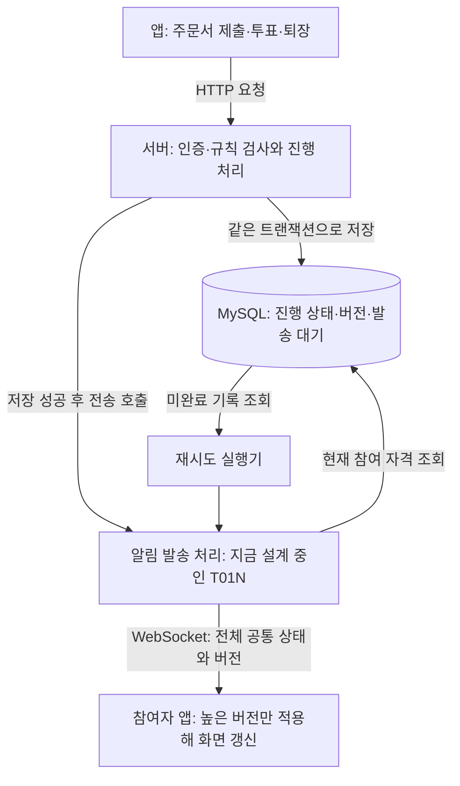

# #36 같이 고르기 전체 구조와 현재 설계 위치

- 기준일: 2026-11-17.
- 상태: 제품 규칙은 명세에 정리했고 티켓별 상세 설계를 진행 중이다. T01 설계는 확인 완료, T01N 설계는 진행 중이다. 이 작업의 애플리케이션 코드는 아직 변경하지 않았다.
- 목적: 개별 선택지를 묻기 전에 기능 전체·데이터 흐름·선택 사이의 연결과 현재 위치를 함께 설명한다. 아래 설계도는 현재 코드의 구현 완료 상태를 뜻하지 않는다.
- 근거: [제품 명세](../specs/36-group-menu-selection-and-voting.md), [티켓 지도](36-ticket-breakdown.md), [T01 설계](36-t01-final-design.md), [T01N 결정 기록](36-t01n-notification-architecture.md).

## 1. 만들려는 사용자 기능

```text
방장이 최소 2명으로 시작
  → 참여자와 공통 제외 조건 고정
  → 각자 기존 개인 주문서 질문에 응답
  → 각 추천 응답의 첫 메뉴 하나씩 모음
  → 같은 메뉴는 하나로 합침
  → 모두 제출하면 자동으로 복수 선택 투표
  → 모두 투표하면 최다 득표 메뉴 표시, 동률은 공동 1위
```

- 후보 하나는 투표 없이 결과로 간다. 후보가 없으면 제외 조건을 풀지 않고 이유를 안내하며 대기 상태로 복귀한다.
- 제출한 답변과 표는 수정하지 않는다. 중간에는 제출 인원만 공개하고 개인 선택과 후보별 중간 표는 공개하지 않는다.
- 중간 퇴장은 진행을 멈추고 방장이 제외 후 계속 또는 라운드 취소를 결정한다. 두 명 미만이면 취소한다. 투표 중 제외 후 계속하면 후보를 정리하고 전원 재투표한다.
- 연결 끊김은 기존 60초 재접속 유예를 유지하며 방장 이탈·유예 만료는 기존 방 종료 규칙을 따른다.
- 다시 고르기와 추가 제외 조건은 여전히 보류다. 이 문서로 결정하거나 보류를 해제하지 않는다.

## 2. 앱·서버·DB의 역할

| 역할 | 담당 내용 |
| --- | --- |
| 참여자의 앱 | 주문서·투표·퇴장 요청, 본인 진행 정보 표시, 공통 상태 수신 후 화면 갱신 |
| 서버의 방·라운드 처리 | 인증·현재 참여 자격·진행 단계·수정 금지 검사, 답변·후보·투표·집계 및 퇴장 처리 |
| 기존 개인 주문서·추천 로직 | 개인 질문 이력과 공통 제외 조건을 적용한 추천. 응답 첫 메뉴를 공동 후보로 연결 |
| MySQL의 진행 상태 | 방·참여·라운드·제출·후보·투표·결과와 상태 버전의 지속 저장. 구체 신규 스키마는 후속 설계 대상 |
| MySQL의 발송 대기 | 보낼 전체 공통 상태와 원래 버전·전송 결과·재시도 시각을 지속 저장. T01N에서 구현할 계획 |
| 알림 발송 처리 | 저장 성공 뒤 현재 수신 자격을 DB에서 확인하고 WebSocket으로 앱에 전달 |
| 재시도 실행기 | DB에 남은 미전송·실패 기록을 정한 시간 안에서 다시 발송 처리로 연결 |

기존 운영 전제는 FastAPI API 프로세스 하나와 MySQL이다. 서버의 화면 갱신 알림은 참여자가 켜 둔 앱의 WebSocket 연결로 전달하는 데이터다. HTTP는 명령과 조회, WebSocket은 상태 전달을 맡는다.



최초 입장·재접속은 HTTP로 최신 상태를 조회해 복구한다. 공통 알림과 달리 조회자별 정보는 권한에 맞춰 반환한다. 전체 공통 상태의 정확한 필드·개인 정보와의 분리는 T01N 남은 계약이다.

D10 1번에 따라 참여·주문서 완료 등 적용 가능한 변경 요청의 성공 HTTP 응답에도 명령 결과와 최종 저장 버전의 전체 공통 상태를 담는다. 요청자는 응답과 알림 양쪽에서 전체 상태를 받을 수 있으며 전체 상태를 실제 적용했을 때만 적용 버전을 올린다. 같은 버전·과거 상태는 화면을 되돌리지 않고 명령의 성공 결과는 별도로 처리한다. 본인 퇴장·방 삭제 응답이나 비참여자 조회의 정보 범위를 확대하지 않는다.

## 3. 한 번의 행동이 흐르는 예

철수가 퇴장해서 세 명이 두 명이 되는 상황을 예로 든다. 버전 20·21과 알림 100은 설명용 식별자다.

1. 철수의 앱이 HTTP 퇴장 요청을 보낸다.
2. 서버는 본인 요청·방 상태를 확인하고 공통 정리로 철수의 참여·완료 기록을 제거한다. 남은 두 명과 완료 인원을 계산한다. 이 실제 삭제·집계의 공통화가 T01이다.
3. T01N은 그 변경과 버전 20→21, 21번의 전체 공통 상태를 담은 알림 100을 같은 DB 트랜잭션으로 저장한다. 실패하면 함께 취소한다.
4. 저장이 성공하면 알림 100의 전송을 시도한다. 이때 현재 방 참여 자격을 DB에서 한 번에 확인해 자격이 있는 연결에만 보낸다.
5. 영희의 앱은 현재 20번보다 높은 21번 상태를 받아 참여자·인원을 두 명 상태로 교체한다. 같은 21번이 다시 오면 무시한다.
6. 전송 실패는 저장된 퇴장을 취소하지 않는다. 발송 대기를 남기고 1·3·5·10·30초 간격으로 재시도하며 최초 실패부터 전체 60초 상한을 지킨다. 실제 유효 접속자가 없으면 수신자 없음으로 종료하고 재접속 조회로 복구한다.
7. 전송 결과 저장 전에 서버가 중단되면 D06 2번을 적용한다. 최초 시작 기록만 있고 결과가 불명확한 알림은 재전송하지 않고 결과 불명 종료한다. 미시작 대기와 최초 실패 기한이 저장된 대기는 구분해 기존대로 복구한다. 서버 중단으로 끊긴 앱은 재접속 후 최신 상태·버전 조회로 화면을 맞춘다.

새 라운드에서 퇴장 후 방장 결정 대기로 전환하는 기능은 T05·T06에서 이 공통 경계와 연결한다. T01·T01N만으로 그 제품 기능이 구현된다고 표시하지 않는다.

## 4. 왜 선택들이 서로 연결되는가

| 확정한 선택 | 얻는 것 | 그 선택 때문에 필요한 것·비용 |
| --- | --- | --- |
| 상태와 발송 대기를 DB에 함께 저장 | 저장 직후 중단·일시 전송 실패에서 다시 시도할 근거 유지 | 발송 테이블·명시적 마이그레이션·재시도·보관 정리 |
| 서버 전송 결과 기준, 프론트 ACK 없음 | 프론트 수신 확인 메시지를 추가하지 않음 | 실제 화면 반영을 확정할 수 없음. 재접속 조회 필요 |
| 일부 전송 실패 때 방 전체에 재전송 | 연결별 전달 테이블 없이 복구 시도 | 이미 받은 앱에도 같은 알림이 갈 수 있음 |
| 증가 버전으로 동일·과거 상태 무시 | 중복·역순 알림이 화면을 되돌리지 않도록 처리 | 상태·버전·알림 내용의 일관성, 프론트 버전 검사 |
| 알림마다 전체 공통 상태 | 중간 알림이 빠져도 이후 최신 알림 하나로 상태 교체 가능 | 전체 상태 구성·저장·네트워크 비용 증가 가능 |
| 수신 자격을 매 전송 전 DB 일괄 확인 | 별도 메모리 참여 명단의 무효화 부담 감소 | 최초 전송·재시도마다 DB 조회·왕복 비용 |
| 단일 API 프로세스 | 여러 프로세스의 연결·처리 권한 동기화를 지금 도입하지 않음 | 여러 프로세스로 늘릴 때 연결과 작업 조정 재설계 필요 |
| 발송 기록별 공통 메모리 잠금 | 첫 전송과 재시도의 같은 기록 동시 처리 방지, 다른 방·기록은 실행 가능 | 공통 진입점과 잠금 수명 관리 필요. 프로세스 간에는 공유되지 않음 |
| 미확인 최초 전송 결과는 재전송 없이 종료 | 미확인 최초 시도의 복구 재전송과 추정 기한 관리 감소 | 해당 알림의 복구 기회 포기. 재접속 최신 조회로 현재 화면 복구 필요 |
| 종료 시 원문 제거·처리 요약만 3일 보관 | 최근 종료 사유 조사 단서 유지, 전체 공통 상태 중복 보관 감소 | 본문 오류 재현 자료 없음. 요약 저장·검색·만료 정리 비용과 3일의 조사 기간 |
| 실제 방 연결은 외래 키 검사, 방 삭제 시 SET NULL·이력 식별 정보 보존 | 존재하지 않는 방 연결을 DB가 거절하고 방 삭제 후에도 종료 요약 조사 가능 | FK 검사·인덱스와 방 삭제 시 연관 연결 갱신·잠금 비용. 방 활성 상태·발송 종료는 코드 검사 필요 |
| 만료 요약 정리는 실행 완료 후 1시간 간격, 100건씩 최대 10묶음 | 대상 확인 횟수와 한 번 실행의 작업량 제한 | 만료 이후 삭제 지연·누적 가능성. 정확한 삭제 시각·처리량은 보장하지 않으며 관측·실측 필요 |
| 변경 성공 HTTP 응답에 전체 공통 상태·버전도 반환 | 요청자가 알림을 기다리거나 정상 성공마다 추가 GET을 하지 않고 전체 상태 갱신 가능 | 응답 크기·중복 전달과 API·앱 처리 변경. 같은 버전 snapshot 일치와 도착 순서 검증 필요 |
| 접속 변화도 같은 방 상태 버전에 포함 | 명단·완료·접속 표시를 같은 순서 규칙으로 갱신하고 과거 상태로의 되돌림 방지 | 끊김·복귀 때 전체 상태 저장·발송 증가. 서버가 관측한 접속 기록이며 실제 네트워크 상태와 지연 차이 가능 |

이것은 선택의 이유와 실제 비용을 연결한 표이며 성능 측정 결과가 아니다. 새 선택을 확정한 것도 아니다.

## 5. 데이터의 저장 위치와 미정인 것

| 데이터 | 위치·근거 | 상태 |
| --- | --- | --- |
| 실제 방 참여·라운드 진행·답변·투표·결과 | MySQL | 지속 저장 방향. 신규 상세 스키마는 후속 티켓에서 설계 |
| 상태 버전·보낼 공통 상태·전송 결과 | MySQL | T01N 확정 방향, 아직 미구현 |
| 실제 연결된 WebSocket 객체 | 서버 메모리 | 기존 구조 |
| 연결된 사용자의 현재 수신 자격 | 전송 전 DB 확인 | D03에서 1번으로 확정 |
| 같은 알림을 지금 누가 처리 중인지 조정 | 같은 API 프로세스의 발송 기록 ID별 공통 메모리 잠금 | D04에서 1번으로 확정, 미구현 |

메모리를 쓸지 DB를 쓸지 시스템 전체에 한 번만 고르는 것이 아니다. 실제 진행 상태를 저장하는 일, 수신 자격을 확인하는 일, 중복 실행을 조정하는 일은 서로 다른 목적이다.

## 6. 확정한 D04와 다음 설계 위치

- 알림 발송에는 저장 직후 즉시 보내는 경로와 미완료 기록을 찾아 재시도하는 경로가 있다. 같은 알림을 두 경로가 동시에 실행할 수 있다.
- D04는 이 공통 발송 처리 안에서 “이 기록은 지금 처리 중”이라고 조정하는 위치를 고르는 질문이다. 추천 메뉴·투표 방식이나 화면 데이터의 형태를 정하는 질문이 아니다.
- 사용자가 1번을 확정했다. 같은 API 프로세스 안의 발송 기록별 메모리 잠금을 공유한다. DB 대기·전송 결과는 그대로 보존하고 재시작 후 미완료 기록을 복구한다. 여러 방을 처리할 수 있으며 같은 알림의 실행만 조정한다.
- 2번은 채택하지 않았다. DB의 기한 있는 처리 권한으로 프로세스 사이에서도 조정할 수 있지만 현재는 여러 프로세스가 필요하다는 근거가 없고, DB 선점·해제·권한 만료 관리가 추가된다. 미래 확장 조건을 현재 필수 선택처럼 설명하지 않는다.
- 공통 발송 코드가 한 곳이라는 것과 같은 서버 프로그램을 여러 프로세스로 실행하는 것은 다르다. 현재는 단일 API 프로세스다. 동접 100명 등의 숫자로 확장을 단정하지 않으며 실제 부하와 필요한 운영 구성을 근거로 판단한다.
- 두 안 모두 이미 보낸 뒤 결과 저장 전에 중단되면 중복 전송이 가능하며, 기존 프론트 버전 검사가 여전히 필요하다.
- D04와 D05는 모두 1번, D06은 2번으로 확정했다. D05에 따라 최초 실패 후 60초 기한에 진행 중인 미완료 전송의 기다림도 중단한다. D06에 따라 최초 시작 기록만 있고 결과가 불명확한 알림은 재전송 없이 결과 불명 종료하며 미시작 대기·저장된 최초 실패 기한의 복구는 유지한다. 기한 이후 새 전송은 시작하지 않으며 이미 나간 데이터의 회수를 보장하는 것은 아니다. D07은 종료 시 원문을 제거하고 처리 요약만 종료 시각부터 3일 보관하기로 확정했다. D08은 1번으로 실제 방 연결에 nullable 외래 키·ON DELETE SET NULL을 사용하고 이력 식별 정보를 별도로 보존한다. 방 삭제로 요약을 지우거나 원래 3일 기한을 늘리지 않는다. D09는 2번으로 만료 요약 정리를 실행 완료 후 1시간 간격, 100건씩 최대 10묶음으로 정했다. 시작 후 첫 실행과 묶음별 실패 복구를 포함하며 삭제 시각·처리량은 보장하지 않는다. 다음은 구체 스키마·관측과 최종 실행·상태 계약이다. T01N 전체 설계와 실행 코드 구현은 아직 완료되지 않았다.

## 7. 티켓별 위치와 진행 상태

| 티켓 | 사용자에게 연결되는 역할 | 현재 상태 |
| --- | --- | --- |
| T01 | 어느 경로로 퇴장해도 같은 참여·완료 상태로 정리 | [최종 설계 완료](36-t01-final-design.md), 미구현 |
| T01N | 모든 참여자 화면 갱신·버전·실패 후 재전송 | [최종 설계 완료](36-t01n-final-design.md) (`D01`~`D12` 전체 확정), 미구현 |
| T02 | 방장 시작·참여자/조건 고정·개인 질문 조회 | [최종 설계 완료](36-t02-final-design.md) (`D01`=1번, `D02`=1번, `D03`=2번 확정), 미구현 |
| T03 | 주문서 제출·개인 첫 메뉴 연결·후보 병합 | [최종 설계 완료](36-t03-final-design.md) (`D01`=1번, `D02`=1번, `D03`=2번, `D20`=1번 확정), 미구현 |
| T04 | 복수 선택 투표·최다 득표·공동 1위 | [설계 진행 중](36-t04-final-design.md) (`D01`=2번 확정, `D02` 확인 중) |
| T05 | 주문서 작성 중 퇴장·방장 계속/취소 | 상세 설계 대기 |
| T06 | 투표 중 퇴장·후보 정리·전원 재투표 | 상세 설계 대기 |
| T07 | 전체 흐름의 재접속·재시작·동시 요청 복구 | 상세 설계 대기. 선행 티켓의 테스트도 각자 수행 예정 |

현재는 추천·투표 자체의 상세 설계에 앞서 기존 방 처리와 실시간 전달 기반을 구체화하고 있다. 화면 동기화의 복구 수준을 높이는 선택으로 T01N 범위가 확장되어 이 부분의 설계가 길어졌다.

## 8. 이후 질문을 설명하는 순서

1. 전체 그림에서 지금 묻는 블록과 연결된 사용자 행동을 먼저 표시한다.
   현재 요구사항에 필요한 결정인지 먼저 밝히고, 미래 확장 대안은 필요한 조건과 지금 추가되는 개발·DB·운영 부담을 명시한다. 현재 필요 없는 대안을 필수 선택처럼 제시하지 않는다.
2. 이미 정한 선택 중 이번 선택을 제한하거나 필요하게 만든 것을 짚는다.
3. 무엇이 달라지고 무엇이 같은지, 정상·실패 상황과 프론트·서버·DB 비용을 비교한다.
4. 사용자 경험·보장 수준·운영 구성을 바꾸는 큰 결정과 내부 구현 위치의 작은 결정을 구분한다. 작은 차이를 큰 아키텍처 차이로 과장하지 않는다.
5. 현재 질문과 남은 설계 묶음을 갱신한 뒤 사용자가 판단하도록 한다. 앞선 선택도 전체 맥락을 보고 재검토할 수 있으며, 이해 확인 없이 재해석해 승인으로 간주하지 않는다.
6. 2026-11-17 사용자가 진행이 오래 걸린다고 알려 설계를 3묶음으로 정리했다. D11 접속 변화의 같은 버전 포함을 확정했으며 남은 진행은 실행·복구와 최종 검토의 2묶음이다. 나머지 공통 필드·조회 세부는 최종 검토에 모으고 일괄 승인으로 간주하지 않는다. 컬럼 이름 같은 내부 세부를 별도 선택으로 늘리지 않고 용어보다 구체 상황을 먼저 설명한다.
7. 현재 실행·복구 묶음 D12는 검토안이다. 실제 전송 결과의 DB 저장이 실패하면 같은 프로세스가 알고 있는 결과를 보존해 저장부터 복구하고 새 전송은 보류하는 방향을 제안했다. D06 결과 불명 종료·기존 최초 실패 기한·방 종료 우선 규칙을 함께 정리했다. 승인 전이며 승인 후 남는 것은 최종 검토 1묶음이다.
