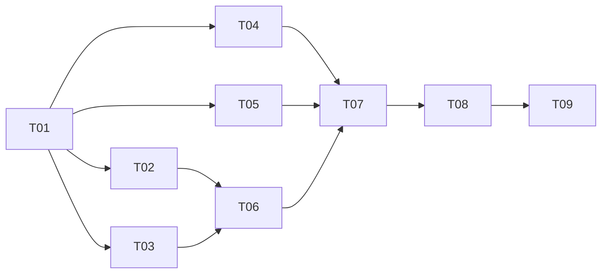

# #39 개발 작업 분할 초안

상태: 사용자 검토 대기. 아래 T01~T09는 계획 번호이며 GitHub 이슈 번호가 아니다. 아직 하위 이슈를 생성하지 않았다.

기준 명세와 모든 작업의 부모: [#39 UUID 기본 이용과 선택적 카카오 기록 이관](https://github.com/pknu-wap/WHATBOB_BE/issues/39).

## 공통 완료 기준

- 각 작업은 필요한 데이터 변경, 서비스·API 동작, 연동 계약과 관련 테스트를 함께 포함한다. DB·API·테스트를 서로 다른 작업으로 나누지 않는다.
- 검증은 합의한 실제 FastAPI REST·WebSocket 경계를 우선한다. 격리 DB·임시 업로드 폴더를 사용하고 카카오 외부 응답과 시간만 통제한다.
- 실제 MySQL 잠금·유일 제약이 필요한 동시성 검증은 해당 기능 작업에 포함한다. 마지막 작업까지 개별 기능 테스트를 미루지 않는다.
- 기존 카카오 사용자와 관련 데이터를 보존하며, 스키마 변경은 각 기능에 필요한 마이그레이션과 함께 제공한다. 기존 내부 정수 PK와 FK를 일괄 교체하지 않는다.
- 기존 데이터의 새 제약 위반은 사전 점검으로 보고하고 임의로 기존 프로필이나 기록을 바꾸지 않는다.
- 명세와 프로젝트의 계층·DTO·오류 응답 관례를 따르고 실제 검증 결과와 남은 검증을 작업 기록에 남긴다.
- 프론트엔드 전체 화면 구현은 범위 밖이다. 실제 화면 연결에 필요한 요청·응답·인증·오류·파일 계약과 호출 순서는 각 작업에서 제공한다.
- 승인 후 작업별 GitHub 하위 이슈와 실제 의존 관계를 생성하고 `ready-for-agent`를 적용한다. 부모 이슈의 본문·제목·상태는 변경하지 않는다.

## T01. UUID 사용자 자동 생성과 재방문 복원

### Parent

#39

### What to build

첫 이용 요청으로 카카오 로그인 없는 UUID 사용자·고유 랜덤 표시 닉네임·기본 프로필 이미지를 제공하고, 같은 브라우저 인증 정보로 재방문하면 같은 사용자로 돌아올 수 있게 한다.

### Acceptance criteria

- [ ] 카카오 ID 없는 사용자 생성과 기존 카카오 사용자 조회가 모두 가능하며, 필요한 데이터 확장·마이그레이션이 기존 기록과 참조를 보존한다.
- [ ] UUID·단어 조합과 숫자 기반 고유 닉네임·기본 이미지 및 내 정보 조회 계약을 제공한다. 생성 이름 충돌을 재시도하고 DB에서도 중복을 제어한다.
- [ ] UUID와 별도의 비밀 인증 정보로 사용자를 검증한다. UUID만 아는 요청이나 타 사용자의 식별자로는 인증되지 않는다.
- [ ] 재방문 복원·접근 토큰 갱신 후 같은 사용자와 닉네임을 반환한다. 별도 브라우저는 독립된 UUID를 받는다.
- [ ] 최초 진입·재방문·만료 후 갱신의 호출 순서와 사용자 유형을 표현하는 응답을 문서화한다.
- [ ] 실제 앱 API 테스트로 생성·복원·갱신·독립 사용자·타인 접근 차단 및 기존 카카오 사용자 회귀를 검증한다.

### Blocked by

없음. 바로 시작할 수 있다.

## T02. UUID 사용자의 개인 추천·제외 조건·식사 기록 연결

### Parent

#39

### What to build

UUID 사용자가 기존 개인 추천, 음식 제외 조건, 식사 기록과 피드백을 본인 데이터로 저장·조회하고 재방문 후에도 이어 쓰게 한다.

### Acceptance criteria

- [ ] UUID 사용자의 알레르기·섭취 불가·비선호를 개인 추천에서 먼저 적용하며, 후보가 없을 때 조건을 풀지 않는다.
- [ ] 비선호와 식사 기록을 저장·조회하고 사용자·일시·메뉴 스냅샷의 기존 의미를 유지한다.
- [ ] 주문서 추천·피드백·질문 순환과 최근 추천 상태가 UUID 사용자에게 연결된다. 개인화를 이유로 새 추천 알고리즘을 도입하지 않는다.
- [ ] 재방문 복원 후 같은 기록을 확인하고, 두 UUID의 데이터가 섞이거나 다른 사용자의 기록을 변경할 수 없음을 검증한다.
- [ ] 기존 카카오 사용자와 익명 추천의 기존 계약에 미치는 영향을 확인하고 필요한 연동 문서를 갱신한다.
- [ ] 실제 API를 통해 제외 조건·후보 없음·저장과 조회·재방문·타인 접근 차단의 통합 테스트가 통과한다.

### Blocked by

- T01

## T03. UUID 방 참여와 30초 재접속 유예·자동 퇴장

### Parent

#39

### What to build

UUID 사용자가 방을 만들고 참여·완료·퇴장할 수 있으며, 마지막 연결이 끊기면 30초 동안 복귀를 기다린 뒤 일반 참여자는 퇴장시키고 방장은 방을 종료한다.

### Acceptance criteria

- [ ] UUID 사용자가 같은 사용자와 표시 닉네임으로 기존 방 REST API와 WebSocket을 이용한다. 카카오 로그인 여부가 방 이용 조건이 되지 않는다.
- [ ] 마지막 연결 종료부터 30초 안에 재접속하면 참여·주문서 완료 상태를 유지한다. 다른 탭의 연결이 남아 있으면 퇴장 유예를 시작하지 않는다.
- [ ] 일반 참여자의 유예가 끝나면 참여자·주문서를 정리하고 인원·완료 집계를 재계산하여 변경 이벤트를 전송한다.
- [ ] 방장의 유예가 끝나면 방 종료 이벤트와 관련 데이터 정리까지 수행한다.
- [ ] 재접속과 만료가 경합하거나 서버가 재시작되어도 오래된 오프라인 참여자가 무기한 남지 않는다. 기존 명시적 퇴장·방 TTL 만료 동작은 유지한다.
- [ ] 실제 REST·WebSocket과 제어한 시간으로 유예 안·밖, 복수 탭, 일반 참여자·방장, 집계·이벤트 및 복구를 검증한다.

### Blocked by

- T01

## T04. 중복 없는 닉네임 편집과 직접 수정 상태 보존

### Parent

#39

### What to build

UUID 사용자와 카카오 사용자가 내 정보에서 표시 닉네임을 바꾸고, 계정 이관 시 직접 정한 이름임을 보존할 수 있게 한다.

### Acceptance criteria

- [ ] 앞뒤 공백 제거 후 2~20자, 한글·영문·숫자·공백 제약을 적용하는 본인 닉네임 편집 API를 제공한다.
- [ ] 다른 사용자의 이름은 충돌 응답으로 거절하고 본인의 이름을 그대로 저장하는 요청은 허용한다.
- [ ] 자동 생성과 직접 편집이 동일한 중복 규칙을 사용하며, 동시 이름 변경에도 한 이름을 두 사용자가 차지하지 않는다.
- [ ] 직접 수정한 사실을 데이터에 보존하고, 편집 성공 후 내 정보와 방 상세 조회에서 같은 이름을 확인한다.
- [ ] 실제 API에서 길이 경계·허용 및 금지 문자·공백·중복·본인 이름 재저장·권한을 검증하고, 동시 충돌은 전용 MySQL 테스트로 보완한다.

### Blocked by

- T01

## T05. 로컬 프로필 사진 업로드·교체·삭제

### Parent

#39

### What to build

UUID 사용자와 카카오 사용자가 기본 이미지 대신 본인 사진을 업로드하고, 교체하거나 삭제해 기본 이미지로 돌아오게 한다.

### Acceptance criteria

- [ ] 본인 사진 업로드·교체·삭제 API와 프로필 조회 응답을 제공한다. 직접 사진을 수정한 사실을 보존한다.
- [ ] JPG·PNG·WebP, 최대 5MB를 허용하며 실제 이미지 내용·용량을 검증한다. 거절·저장 실패 시 기존 사진과 프로필을 유지한다.
- [ ] 설정 가능한 로컬 데이터 디렉터리와 서버 생성 파일명을 사용한다. 업로드 파일을 Git에 포함하지 않고 임의 경로나 다른 사용자의 파일을 수정할 수 없게 한다.
- [ ] 업로드 사진을 실제로 조회할 수 있고, 삭제하면 기본 이미지로 복귀한다. 교체·삭제는 참조와 소유권을 확인한다.
- [ ] 임시 폴더를 사용하는 실제 API 통합 테스트로 업로드·조회·교체·삭제·형식과 용량 경계·실패 시 보존을 확인한다.
- [ ] 운영용 저장소나 클라우드 리소스를 생성하지 않는다. 추후 저장소 추가 시 API 계약을 유지할 수 있게 파일 저장 책임을 분리한다.

### Blocked by

- T01

## T06. 단일 UUID 기록을 새 카카오 계정으로 이관

### Parent

#39

### What to build

개인 기록이 있는 한 UUID 사용자가 처음 연결하는 카카오 계정으로 로그인하여, 기록과 프로필을 이어 쓰고 원본 UUID는 폐기하도록 한다. 방 참여 중 계정 전환을 막는 검사도 이 경로에서 적용한다.

### Acceptance criteria

- [ ] 현재 UUID 인증과 카카오 계정 인증을 모두 확인한 뒤 신규 계정으로 제외 목록·식사·추천·피드백·질문 순환 상태를 이관한다.
- [ ] 원본 기록의 ID·일시·평가 순서와 UUID 프로필 출처 시점을 보존하고, 단순히 카카오 닉네임·사진으로 교체하지 않는다.
- [ ] 원본 UUID와 인증 정보는 이관 성공 후 폐기하고 현재 브라우저를 카카오 계정 인증 상태로 전환한다.
- [ ] 카카오 인증·저장 실패, 잘못된 사용자 요청 또는 상태 충돌 시 원본 UUID와 모든 기록을 보존한다. 이관 중간에 부분 커밋이 발생하지 않는다.
- [ ] 현재 사용자가 유효한 방 또는 30초 유예 상태에 있으면 로그인·이관을 거절한다. 방 생성·참여와 경합해 제한을 우회할 수 없게 한다.
- [ ] 실제 API에서 데이터가 있는 UUID의 최초 로그인, 데이터 보존, 인증 전환·원본 인증 무효화 및 실패 롤백을 검증한다. MySQL에서 필요한 동시 상태 검증도 제공한다.
- [ ] 기존 카카오 로그인은 유지한다. 새 UUID 이관 경로의 기존 계정 병합은 T07 완료 전까지 원본을 보존한 채 거절하여, 처리하지 않은 대상 기록을 잃지 않게 한다.

### Blocked by

- T02
- T03

## T07. 기존 카카오 계정과 여러 UUID의 무손실 병합

### Parent

#39

### What to build

다른 UUID로 같은 카카오 계정에 로그인해도 기록을 모두 합치고, 기존 계정·가장 오래된 UUID·직접 편집한 프로필의 우선순위를 적용한다. T06의 기존 계정 병합 제한을 완성된 동작으로 대체한다.

### Acceptance criteria

- [ ] 기존 카카오 계정에 이관하고 별도 계정을 중복 생성하지 않는다. UUID 도입 이전부터 존재한 카카오 계정의 프로필·기록은 보존한다.
- [ ] 각 브라우저에서 같은 계정으로 인증한 UUID만 이관한다. 이관 성공 후 원본 UUID는 폐기한다.
- [ ] 음식 제외 조건은 유형별로 모두 합치고 같은 항목만 중복 제거한다. 합계 100개가 넘어도 자르지 않으며 전체 목록을 조회·편집할 수 있다.
- [ ] 식사·추천·피드백의 원본 ID·일시·최신 평가 순서를 보존하고 질문 순환 상태도 합친다. 재시도나 동시 로그인으로 같은 기록이 중복 이관되지 않는다.
- [ ] 신규 연결 계정은 가장 먼저 생성된 UUID의 프로필을 기준으로 한다. 나중에 더 오래된 UUID가 연결되는 경우도 출처 시점으로 판정한다.
- [ ] 카카오 계정에서 직접 수정한 닉네임·사진은 이후 이관으로 덮어쓰지 않는다. 사진 이관 후에도 조회되며 참조 중인 업로드 파일을 잘못 삭제하지 않는다.
- [ ] 대상 카카오 계정이 다른 기기에서 유효한 방 또는 유예 상태에 있으면 로그인·병합을 거절하고 양쪽 데이터를 보존한다.
- [ ] 실제 API에서 다중 UUID·기존 계정·프로필 순서 역전·직접 편집·대용량 제외 목록·재시도·실패를 검증한다. 전용 MySQL에서 동시 이관과 닉네임·계정 유일성을 검증한다.

### Blocked by

- T04
- T05
- T06

## T08. 로그아웃 후 새 UUID 생성과 재로그인 기록 연결

### Parent

#39

### What to build

카카오 사용자가 로그아웃하면 새 UUID·랜덤 닉네임으로 시작하고, 이후 새 활동을 한 뒤 다시 로그인하면 기존 카카오 기록에 합쳐지도록 한다.

### Acceptance criteria

- [ ] 로그아웃한 브라우저의 카카오 인증을 폐기하고 새 UUID·고유 랜덤 닉네임·기본 이미지와 인증 상태를 제공한다.
- [ ] 카카오 계정의 기존 프로필·기록은 유지되고 새 UUID의 활동과 분리된다.
- [ ] 새 UUID로 저장한 기록을 재로그인 때 같은 계정으로 합치며 새 UUID와 해당 인증을 폐기한다.
- [ ] 방 참여 중과 30초 유예 중에는 로그아웃을 거절하고, 참여가 종료되면 허용한다. 방 참여와 로그아웃의 동시 요청도 제한을 우회하지 못한다.
- [ ] 실제 API로 로그인·로그아웃·새 UUID 개인 이용·재로그인의 왕복 흐름, 이전 인증 무효화와 기록 보존을 검증하고 필요한 MySQL 경합 테스트를 포함한다.
- [ ] 프론트가 인증과 사용자 유형을 교체하는 응답·오류·호출 순서를 문서화한다.

### Blocked by

- T07

## T09. 전체 사용자 전환 흐름과 기존 데이터 회귀 검증

### Parent

#39

### What to build

기존 카카오 데이터가 있는 DB를 전환하고, 첫 UUID 이용부터 프로필 편집·방 복귀·카카오 이관·로그아웃·재로그인까지 이어지는 전체 흐름을 검증 가능한 상태로 마무리한다.

### Acceptance criteria

- [ ] 기존 카카오 계정과 관련 기록을 가진 테스트 DB에 마이그레이션을 적용하고 데이터·참조 보존을 확인한다. 새 제약 충돌을 사전 점검으로 명확히 보고한다.
- [ ] UUID 생성·재방문·개인 기록·닉네임과 사진 편집·방 이용·30초 복귀와 만료·카카오 이관·로그아웃·재로그인을 연결한 대표 시나리오를 검증한다.
- [ ] 기존 인증·내 정보·비선호·식사·추천·피드백·방 REST·WebSocket 테스트의 회귀 결과와 전용 MySQL 동시성 결과를 기록한다.
- [ ] 실제 API·인증 복원·오류·업로드·WebSocket 계약을 연동 문서와 맞추고, 프론트 전체 화면 구현을 완료한 것으로 보고하지 않는다.
- [ ] 실행한 검증과 미실행 검증을 구분한다. 테스트 DB·환경이 없어 확인하지 못한 MySQL 또는 브라우저 연동을 통과했다고 표시하지 않는다.
- [ ] 개발 사진은 로컬 저장을 유지하고 운영 저장소·배포 및 공동 후보 계산은 범위 밖으로 유지한다.

### Blocked by

- T08

## 명세 시나리오 대응

| 작업 | 주 검증 대상 User Stories 번호 |
| --- | --- |
| T01 | 1~5, 12 |
| T02 | 6~9 |
| T03 | 10~11, 46~52 |
| T04 | 31~35 |
| T05 | 36~40, 55~56 |
| T06 | 13~14, 18~20, 30, 44, 53~54 |
| T07 | 15~17, 21~29, 45 |
| T08 | 41~44, 53~54 |
| T09 | 1~56의 주요 흐름과 기존 데이터 회귀 |

## 구현 순서와 의존성

1. T01을 먼저 완료한다.
2. T02·T03·T04·T05는 T01 이후 서로 독립적으로 진행할 수 있다.
3. T02와 T03이 완료되면 T06을 시작할 수 있다. T04·T05 완료를 기다릴 필요는 없다.
4. T04·T05·T06이 완료되면 T07을 시작한다.
5. T07 이후 T08, T08 이후 T09 순서로 진행한다.

## 검토와 게시

작업 크기, 필요한 선행 조건, 합치거나 더 나눌 항목을 사용자에게 확인한 뒤 게시한다. 실제 이슈는 의존성 순서대로 만들고 #39의 하위 이슈로 연결한다. 게시 후에는 계획 번호를 실제 이슈 번호로 대응시키고 가능한 경우 GitHub 기본 차단 관계를 사용한다.
